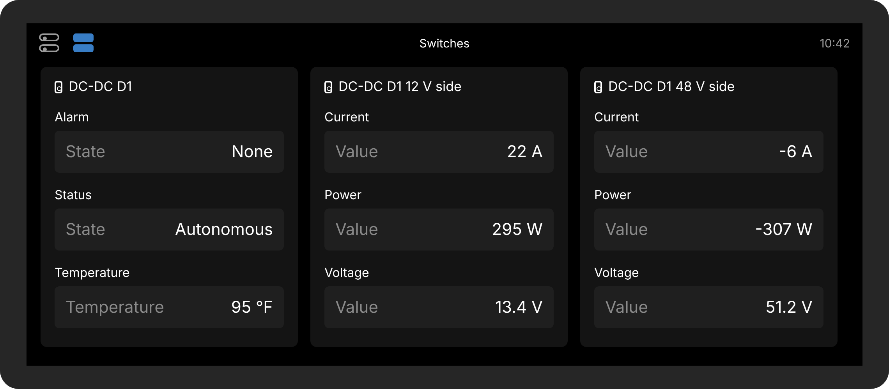

# Nomadic D1 and D2 monitor for the Victron Cerbo GX

**See what your Nomadic DC-DC converter is doing, right on your Cerbo GX screen, in the VRM app, or on a tablet.**

Made for owners of **Grand Design Lineage LTV vans**, and anyone else with a Nomadic **D1** or **D2** DC-DC
converter and a Victron **Cerbo GX**. No programming needed: download one file, put it on a USB stick, and restart
the Cerbo.

> [!NOTE]
> **Monitor only. It only watches and never touches the converter.** It reads the converter's messages and shows
> them. It has no way to send the converter anything, so it can't change how the converter or your van behaves.
> This is a free owner project. It isn't made by, or affiliated with, Victron Energy, Nomadic or Grand Design.

---

## What you'll see

- **Volts and amps on both sides:** the 12 V side (chassis batteries) and the 48 V side (the house battery).
- **Which way the energy is going:** **Boost** (the engine's alternators charging the 48 V battery) or **Buck**
  (the 48 V battery powering the 12 V side).
- **The converter's temperature**, with a warning on the Cerbo at 212 °F and an alarm at 221 °F, the point
  where the converter starts cutting back its power.
- **Faults and alarms** from the converter, in plain words.
- **History:** lowest and highest voltages and temperature, and kWh in each direction, on the Cerbo's History page.
- **A web page with 24-hour charts** that any tablet, phone or laptop on the van's network can open at
  `http://<your-cerbo's-address>:8088`.

The converter appears on the Cerbo's Overview as an **Alternator** tile, and its readings appear in the switch
pane and in the **VRM** app.

## Step 1: Which converter do I have?

Look at the label on the converter. On an LTV it's usually near the 48 V battery.

| You have | Use this folder | Download this file |
|---|---|---|
| **Nomadic D1** (four thin labelled wires: CAN_H, CAN_L and two 12 V wires) | [D1-monitor](D1-monitor) | [`venus-data-nomadic-d1-monitor.tar.gz`](https://github.com/CKOCI13/Nomadic-D1-and-D2-monitor-on-Victron-Cerbo-GX-MK2/raw/main/Download/venus-data-nomadic-d1-monitor.tar.gz) |
| **Nomadic D2** (only two thin wires: CAN_H and CAN_L) | [D2-monitor](D2-monitor) | [`venus-data-nomadic-d2-monitor.tar.gz`](https://github.com/CKOCI13/Nomadic-D1-and-D2-monitor-on-Victron-Cerbo-GX-MK2/raw/main/Download/venus-data-nomadic-d2-monitor.tar.gz) |

Install only **one** of them, the one that matches your converter.

## Step 2: What you need

- A **Cerbo GX** running **Venus OS v3.80 or newer** (Settings › General › Firmware shows the version).
- A **network (Ethernet) patch cable**, two **3-way lever wire connectors** (for example WAGO 221-413) and a
  **120 Ω resistor**. You cut one end off the cable and join it to the converter's CAN_H and CAN_L wires.
- A **USB stick** or microSD card.

The **Installation Guide** has pictures of every step, including how to make the cable:
[D1 guide (PDF)](D1-monitor/docs/installation-guide.pdf) · [D2 guide (PDF)](D2-monitor/docs/installation-guide.pdf)

## Step 3: Connect the cable and set up the CAN port

1. Plug the cable into one of the Cerbo GX MK2's **VE.Can 2** sockets. On an LTV, VE.Can 1 is already used by
   the Firefly and the Lithionics battery. Put the Victron terminator plug that came with the Cerbo in the other
   VE.Can 2 socket.
2. On the Cerbo, go to **Settings › Connectivity › VE.Can port 2** (some firmware calls it **BMS-Can port**) and
   set **CAN-bus profile** to **CAN-bus BMS LV (500 kbit/s)**. That's the speed that worked in an LTV1. If the
   converter doesn't show up, try **VE.Can (250 kbit/s)**. The Installation Guide explains both.

## Step 4: Install it from a USB stick

1. **Download your file** (version 2.5.0). Click one, and it downloads straight away:
   - Nomadic **D1**: **[venus-data-nomadic-d1-monitor.tar.gz](https://github.com/CKOCI13/Nomadic-D1-and-D2-monitor-on-Victron-Cerbo-GX-MK2/raw/main/Download/venus-data-nomadic-d1-monitor.tar.gz)**
   - Nomadic **D2**: **[venus-data-nomadic-d2-monitor.tar.gz](https://github.com/CKOCI13/Nomadic-D1-and-D2-monitor-on-Victron-Cerbo-GX-MK2/raw/main/Download/venus-data-nomadic-d2-monitor.tar.gz)**

   They're also in the [Download](Download) folder. On a Mac, use Chrome or Firefox, not Safari.
2. **Copy it to the top level of the USB stick**, not inside a folder. Put only that one file on the stick. If your
   computer renamed it to something like `... (1).tar.gz`, rename it back exactly as shown in the table above.
3. On the Cerbo, check that **Settings › General › Modification checks** allows modifications (that's the default).
4. **Put the stick in the Cerbo and restart it** (Settings › General › Reboot).
5. **Wait about 2 minutes**, then take the stick out. The Cerbo renames the file to `...installed` so it never
   installs twice.
6. Open the **switch pane** or the **Overview** on the Cerbo. The converter should be there.

It starts by itself every time the Cerbo starts, including after Victron firmware updates.

**Shows "No communication"?** Check that the converter has power, check the cable, the resistor and the
terminator, and try the other CAN speed. The Installation Guide's troubleshooting page goes through it.

**Updating to a newer version:** do Step 4 again with the new file. Your history is kept.

**Removing it:** see "How do I remove it?" in the [D1](D1-monitor/README.md#faq) or [D2](D2-monitor/README.md#faq) README.

## Important for stock LTV vans

> [!WARNING]
> **This monitor shows the current. It does not limit it.** On a stock LTV, the 12 V cable is 2 AWG on a
> 150 A fuse, and the converter can draw more than that while boosting. The monitor lets you *see* how high the
> current goes, but it can't protect the wiring. Talk to Grand Design or Nomadic about the lasting fix.

## How well tested is it?

- **D1:** running in a Grand Design LTV1 since November 2026 (Cerbo GX MK2, Venus OS v3.85). It showed boosting
  from the engine, the temperature and the history correctly.
- **D2:** uses the same messages as the D1 and the same tested code. A few LTV owners are running it, but it
  hasn't been tested by the author yet. If you have a D2, please share what you see.

Both pass over 100 automated checks every time anything changes.

## Questions, problems, or it works for you?

Post in the owners' Facebook group, or open an [issue here on GitHub](../../issues). A photo of the Cerbo
screen helps a lot.

## For the technically curious

- Each folder has its own detailed README, the **Safe Test Plan**, a plain-English
  **How it works** page, and a Windows helper (`Cerbo Setup.bat`) for installing over the network instead of a USB stick.
- The **control versions**, which can also command the converter, are for developers and are still being tested.
  They live in separate repositories: [cerbo-nomadic-d1](https://github.com/CKOCI13/cerbo-nomadic-d1) and
  [cerbo-nomadic-d2](https://github.com/CKOCI13/CKOCI13-cerbo-nomadic-d2). Owners should use this monitor.
- The monitor files here are copies of the developer monitor repositories
  ([D1](https://github.com/CKOCI13/cerbo-nomadic-d1-monitor), [D2](https://github.com/CKOCI13/CKOCI13-cerbo-nomadic-d2-monitor)),
  updated here once each version has been tested.

## License

[MIT No Attribution](LICENSE): free to use, copy and share. It comes with **no warranty**. Victron Energy, Cerbo GX,
Venus OS and VRM are trademarks of Victron Energy B.V. Nomadic, D1 and D2 belong to their owner.
